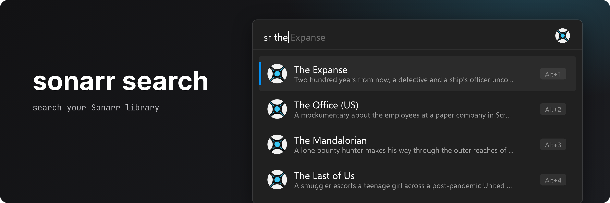

<!-- generated by readwright from docs/README.md.j2; edit the template, not this file -->


# Sonarr Search

Search your Sonarr library from Flow Launcher, and add new shows.

[](https://github.com/Garulf/Sonarr-Search/actions/workflows/tests.yml) [](https://github.com/Garulf/Sonarr-Search/releases/latest) [](https://github.com/Garulf/Sonarr-Search/releases/latest)

[](https://www.buymeacoffee.com/garulf) [](https://github.com/sponsors/Garulf)

## Features

* **Search your library.** Every show on your Sonarr server, matched by title.
* **Open a show in Sonarr.** `Enter` opens the show's page in your browser.
* **Add new shows.** When nothing in your library matches, Sonarr's lookup suggests shows to add.

## Usage

Type `sr` followed by part of a show's title:

```
sr the
```


`sr` on its own lists your whole library.

### Add a new show

If no show in your library matches, the results come from Sonarr's series lookup. Select one to
open Sonarr's **Add New** page with your search filled in:


### Context menu

Open the context menu (`Shift+Enter` or right-click) on a show to open it in your browser:


## Installation

### Flow Launcher

In Flow Launcher, type:

```
pm install sonarr search
```


### Manual installation

Download `Sonarr-Search-<version>.zip` from the [latest release](https://github.com/Garulf/Sonarr-Search/releases/latest) and unzip it into
`%appdata%\FlowLauncher\Plugins`, then restart Flow Launcher.

Pre-releases of the next version are published from the open release PR on the
[releases page](https://github.com/Garulf/Sonarr-Search/releases) for testing. Flow Launcher won't offer them as updates.

## Configuration

Open **Settings → Plugins → Sonarr Search** in Flow Launcher:

| Setting | Default | Description |
| --- | --- | --- |
| Sonarr URL | `http://localhost:8989/` | Your Sonarr URL, including `http://` or `https://` and the port |
| API Key | | Your Sonarr API key, from **Settings → General → Security** in Sonarr |

## Requirements

* Sonarr v3 or v4
* Flow Launcher 1.17.0 or newer
* Python 3.8 or newer, which Flow Launcher can install for you
